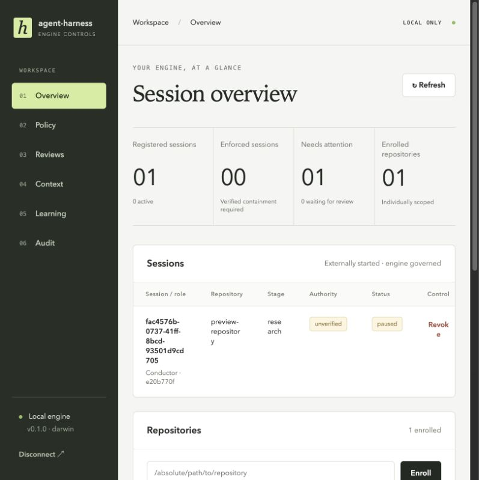
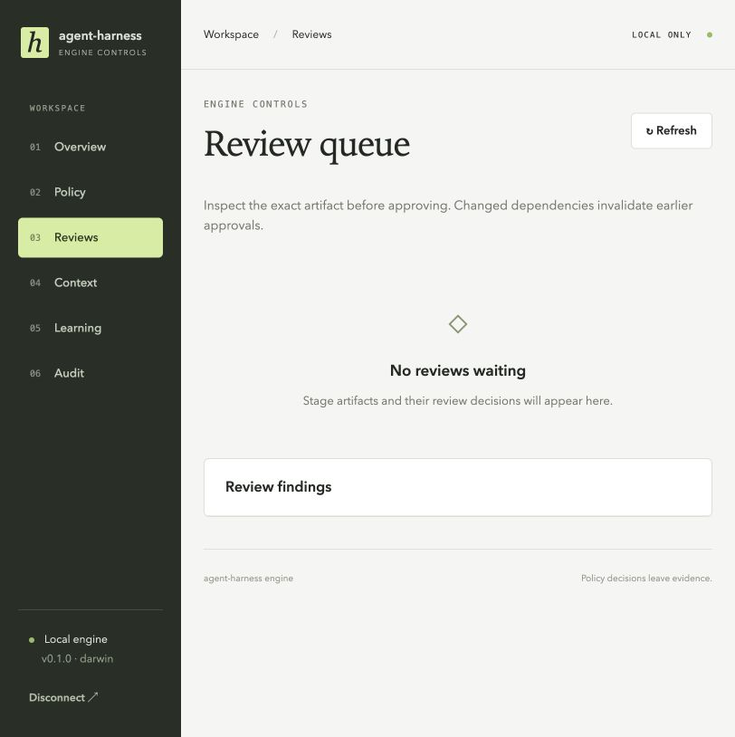
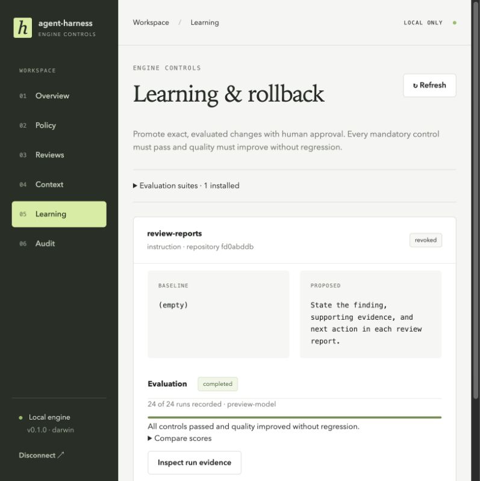
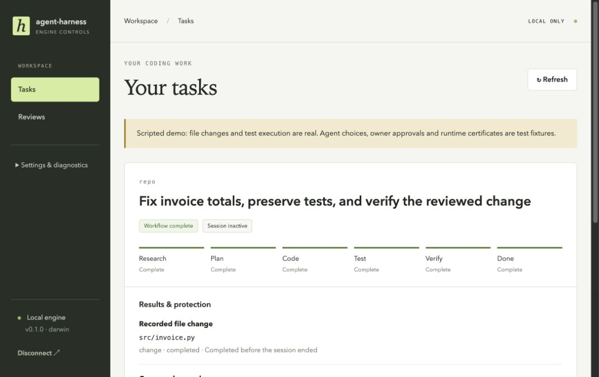

# Demo focus review

Date: 2026-09-25

## Verdict

The implementation broadly follows the engine specification, but the visible experience does not yet communicate the core product. Work has prioritized infrastructure coverage and learning evaluation before a coherent coding-task demonstration. The immediate priority should be a small, real OpenCode task with visible review, controlled effects, and a verified result.

The specification explicitly puts OpenCode first, keeps root-session launch in the external runtime, and places Codex after the first release. The full release checklist remains necessary for release claims; it should not determine the order of the first demo story.

## Evidence and limits

This review captured the current local preview and inspected `docs/plan.MD`, `web/App.tsx`, the preview setup, and the live specialist test. The preview is a disposable evaluation fixture: it has scripted provider responses and no attached coding runtime. Its paused session follows the promotion/rollback check. Its empty review queue is a fixture condition, not proof that reviews are unimplemented.

The live specialist test exercises five reviewed stages, but its implementation/execution artifacts do not establish a real code edit followed by command execution. Separate broker and worker tests are valuable mechanism evidence; combining them into the user journey remains important demo work.

## Captured steps

### 1. Overview — weak task orientation



Strength: authority and session state are explicit, including unverified status.

Problem: the first screen foregrounds counts, identifiers, enrollment and readiness. The session row does not explain the user's goal, current agent activity, reason for its pause, or the next useful action. Revoke is the only row action. At the captured width, identifiers and even short words wrap awkwardly.

Recommendation: lead with the task title, repository name, current stage, agents working on it, and any decision needed. Put setup and runtime details behind a secondary control. Preserve truthful enforcement status.

### 2. Reviews — clear empty state, no demonstrable decision



Strength: the page tells the owner to inspect the exact artifact before approval.

Problem: the current preview has no change or finding to review. It cannot demonstrate why the review gate matters. The implementation presents stage/artifact identifiers and a separate inspection action, rather than a task-centered summary of what changed, the finding, and the consequence of approval.

Recommendation: the demo should arrive here with a real proposed change, a readable diff, the review finding, and one clear approval or correction decision. Connect this directly to the same task shown on the overview.

### 3. Learning — detailed secondary feature dominates available evidence



Strength: baseline/proposal content, evaluation results and rollback state are visible; detailed scores can be disclosed on demand.

Problem: this is the richest flow in the current preview, while the central coding journey is absent. Suite import, model runs and promotion terminology add concepts before the audience has seen useful work. A revoked candidate still has a green historical evaluation result; that is accurate history but needs clearer distinction from what is currently applied.

Recommendation: move this behind Advanced for the first demo. If learning is demonstrated, use a short follow-up to the completed task: suggested instruction, supporting comparison, owner approval, rollback. Keep suite authoring and raw replies in diagnostics.

## A focused demo

1. Start one OpenCode task from the terminal against a prepared sample repository. The web interface observes it; it does not launch the root.
2. Show the task goal and specialist progress in one place.
3. Present one real proposed code change and review decision.
4. Apply the approved change through the broker and run its approved test through the worker. Show the diff and actual result.
5. Attempt one prohibited action and show that it was blocked without an effect, with a short reason and supporting evidence.
6. Finish with changed files, test outcome and task completion. Treat compaction/learning as optional follow-up demonstrations.

## Scope decisions

| Keep prominent | Put behind details/settings | Later than this first demo |
| --- | --- | --- |
| Task goal, progress, specialists, review decision, changed files, test result, enforcement state | Policy editor, model settings, identifiers, certificates, raw audit records, context internals, evaluation-suite authoring | Codex adapter demo, broad administration polish, advanced learning demonstrations |

Keep the existing enforcement mechanisms and tests. Simplify presentation and change implementation order rather than weakening controls. Do not label a fixture preview as a live coding demonstration or a passing demo as full release certification.

## Accessibility risks

The captured session table has poor readability at the current panel width. Small muted text may present a contrast/readability risk; no contrast ratios were measured. Navigation uses real buttons and status badges include text, which are useful foundations. Keyboard order, screen-reader announcements, zoom behavior and full WCAG compliance were not evaluated in this focused review.

## Recommended next milestone

Deliver one honest, repeatable OpenCode demonstration from task entry through reviewed edit, executed test and blocked action. Build its task-centered summary using existing engine records. Complete and preserve the current evaluator work separately; do not expand its UI before the main journey is convincing. Retain the full specification as the release backlog.

## Implemented follow-up — 18 October 2026

The default screen now shows task goals, stage progress, recorded file changes, command results and blocked requests. Tasks and Reviews are primary navigation; policy, context, learning and audit remain under Settings & diagnostics. Repository setup, agent identifiers and technical evidence are disclosed on demand. Command output is readable text in a keyboard-accessible dialog, with focus restored on close.



The repeatable OpenCode integration now supplies this view with real broker edits and isolated execution: an invoice fix, three passing Python tests and a rejected test-file deletion. Provider choices, owner decisions and certificates remain scripted fixtures, explicitly identified in the preview. This verifies mechanics, not autonomous model quality or release certification. A presenter-controlled pause at review remains the next demo improvement.

Verification: 126 tests passed on macOS and in the Linux test container; the final UI build passed. Browser checks covered output inspection, Escape/focus restoration and a 390px viewport without horizontal overflow. The live workflow completed 68 provider requests, fourteen assignments and five stages; seven runtime containers and one worker were removed.

### Repeat the disposable preview

Build the web bundle with `npm run build`, then run the fixture directly so its preview address is printed without test-runner buffering:

```sh
DOCKER_CONTEXT=colima-agent-harness \
HARNESS_TEST_WORKER_IMAGE=<built-worker-image-id> \
HARNESS_DEMO_PREVIEW=1 \
node --import tsx conformance/live/specialists-opencode.test.ts
```

Use the printed local address and disposable credential. Ctrl+C ends the preview and removes its temporary repository and state. This requires the pinned OpenCode runtime and worker image described in the runtime documentation.
